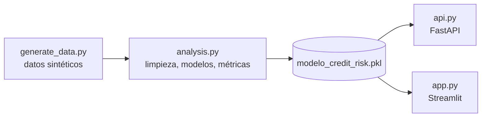

<div align="center">

# Scoring de riesgo crediticio

**¿Este emprendedor pagará su microcrédito? Un modelo lo estima antes de desembolsar.**

Universidad Estatal Amazónica · Tecnologías de la Información · Minería de Datos


</div>

---

## De qué trata

La entidad de microfinanzas, veía crecer la mora (impago a 90 días) en su cartera de microcréditos. Evaluar cada solicitud a mano era lento y las consultas a burós de crédito dejaban fuera a emprendedores sin historial bancario.

Este proyecto toma **7,500 solicitudes** (ya depuradas) y entrena modelos de clasificación supervisada que estiman la probabilidad de *default*. El mejor modelo queda guardado en un archivo y se ofrece de dos formas: una **API REST** y un **panel web** para los oficiales de crédito.

## Resultado en una mirada

| | Regresión Logística | Árbol de Decisión | Random Forest |
|---|:---:|:---:|:---:|
| Accuracy | **0.9220** | 0.8760 | 0.8913 |
| Precision | 0.8419 | 0.7725 | **0.8476** |
| Recall | **0.7112** | 0.4657 | 0.5018 |
| F1-Score | **0.7710** | 0.5811 | 0.6304 |
| AUC-ROC | **0.9553** | 0.8933 | 0.9347 |
| CV AUC-ROC (K=5) | **0.9557 ± 0.0050** | 0.9019 ± 0.0090 | 0.9359 ± 0.0043 |

> Métricas sobre el conjunto de prueba (1,500 registros). La Regresión Logística fue el modelo elegido y el que se desplegó.

Las variables que más pesan en el impago son el **ratio cuota/ingreso**, la **mora histórica**, el **índice de capacidad de pago** y el **score de buró**.

## Cómo funciona el flujo



1. **Datos.** `generate_data.py` crea 7,525 registros con 21 variables, con semilla fija (`seed=42`) para que se pueda reproducir.
2. **Análisis.** `analysis.py` depura los datos, crea las variables derivadas, entrena y compara los tres modelos y guarda el mejor.
3. **Despliegue.** El archivo `.pkl` guarda el modelo, el escalador `StandardScaler` y la lista de variables. Tanto la API como el panel lo cargan para predecir.

## Qué se le hizo a los datos

| Paso | Detalle |
|---|---|
| Duplicados | 25 registros eliminados, quedando 7,500 |
| Nulos | 15 valores en `gastos_familiares_mensuales`, rellenados con la mediana (350.96 USD) |
| Escalado | `StandardScaler` (media 0, desviación 1) |
| Categorías | One-Hot Encoding con `drop_first=True` |
| Partición | 80% entrenamiento (6,000) y 20% prueba (1,500), estratificada; tasa de default de 18.56% en ambas |

### Variables derivadas

```text
Ratio_Cuota_Ingreso   = cuota_mensual / ingreso_mensual
Indice_Capacidad_Pago = (ingreso_mensual - gastos_familiares_mensuales) / (cuota_mensual + 1)
Cobertura_Garantia    = valor_garantia / (monto_credito + 1)
```

### Configuración de los modelos

```python
# Regresión Logística
solver='lbfgs', C=1.0, max_iter=1000, random_state=42

# Árbol de Decisión
criterion='gini', max_depth=6, min_samples_leaf=20, random_state=42

# Random Forest
n_estimators=200, max_depth=8, criterion='gini', random_state=42
```

## Estructura del repositorio

```text
.
├── data/                   datos del proyecto
├── figs/                   gráficos generados
├── scratch/
│   └── test_api_app.py     pruebas de la API y la app
├── generate_data.py        generación de datos 
├── analysis.py             pipeline completo de análisis y modelado
├── api.py                  servicio FastAPI
├── app.py                  panel Streamlit
├── modelo_credit_risk.pkl  modelo + escalador + lista de variables
├── report_data.json        datos usados para el informe
├── requirements.txt        dependencias
```

## Puesta en marcha

Requiere **Python 3.10 o superior**.

```bash
# 1. Instalar dependencias
pip install -r requirements.txt

# 2. Generar los datos (semilla fija)
python generate_data.py

# 3. Ejecutar el análisis y entrenar los modelos
python analysis.py

# 4a. Levantar el panel web
streamlit run app.py

# 4b. Levantar la API
uvicorn api:app --reload
```

> Los comandos del paso 4 asumen que la aplicación FastAPI se llama `app` dentro de `api.py`. Si en tu código tiene otro nombre, ajusta `api:app`.

## Usar la API

La API expone `POST /predict_credit`. Recibe un JSON con los datos del solicitante, calcula las variables derivadas, aplica el escalado y devuelve:

- la **probabilidad de default**,
- el **dictamen comercial**,
- la **categoría de riesgo**.

Con el servidor en marcha, la documentación interactiva (Swagger) está en `/docs`, donde se puede probar el endpoint sin escribir código y ver qué campos pide.

## Reglas de decisión sugeridas

Con p̂ como la probabilidad de default que entrega el modelo:

| Riesgo | Acción |
|---|---|
| Bajo | Aprobación automática (ratio cuota/ingreso bajo y score de buró > 650) |
| Moderado | Revisión manual; se puede pedir garante o ampliar el plazo |
| Alto (p̂ ≥ 0.50) | Rechazo automático por sobreendeudamiento crítico |

## Ideas para seguir

- Mover el umbral de clasificación de 0.45 a 0.35 para superar 80% de Recall.
- Sumar datos alternativos: facturación electrónica, flujo de caja de puntos de venta y pagos de servicios básicos.
- Reentrenar cada trimestre y vigilar el *data drift*.


*Carrera de Tecnologías de la Información · Universidad Estatal Amazónica (UEA)*
